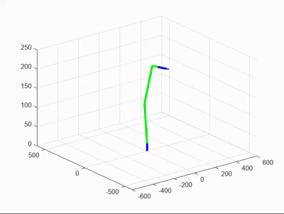
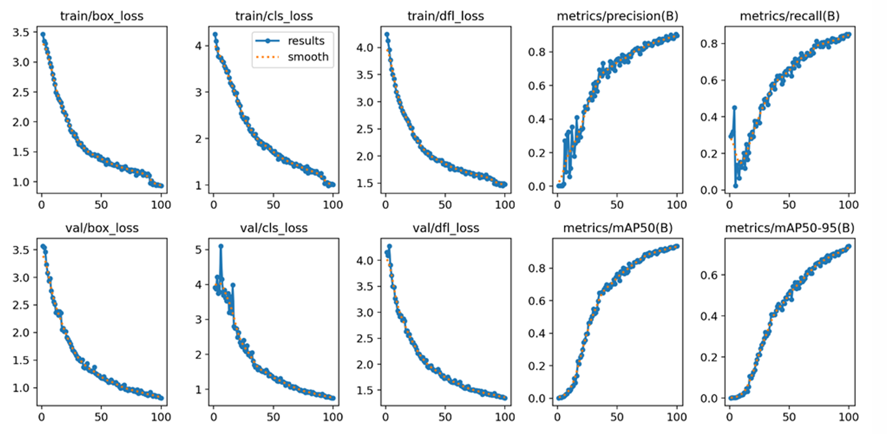
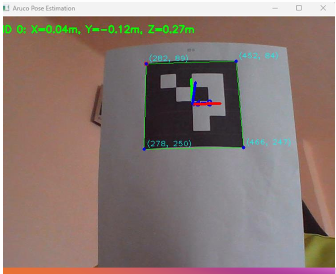
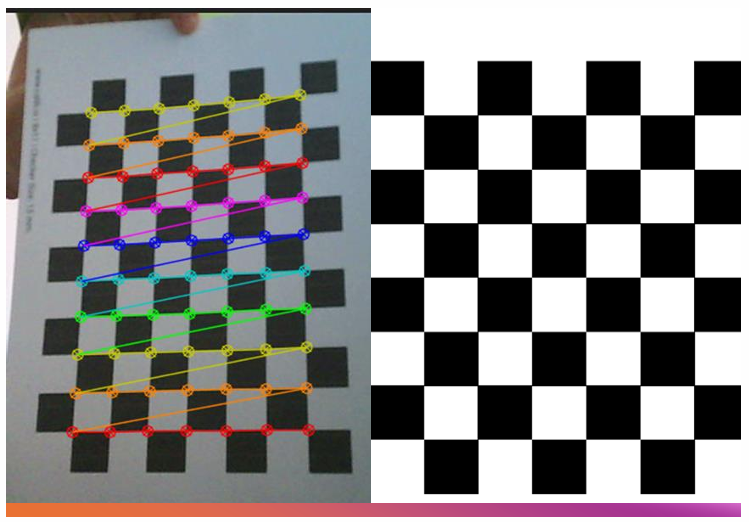
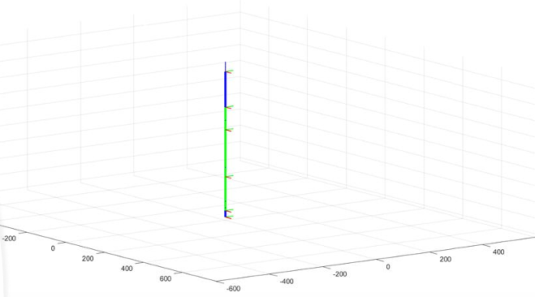

# Robotic Arm for Sorting Recyclable Waste

## Overview

This project proposes the development of a robotic arm mounted on a mobile chassis. The system is capable of automatically detecting and sorting recyclable waste based on material type, specifically plastic, aluminum, glass, and cardboard. The main objectives are to automate the waste sorting process, increase recycling efficiency, reduce human involvement in potentially unhealthy environments, and contribute to a sustainable waste management system

  

## Features

- Automatic detection and sorting of recyclable materials like plastic, aluminum, glass, and cardboard.
- Mobility provided by a tank-type chassis equipped with two DC motors.
- Visual interface and material detection powered by a custom-trained YOLOv8 model.
- Object position determination using ArUco marker detection, OpenCV, and Pose Estimation.
- Inverse kinematics calculations using the Jacobian matrix to generate "pick and place" commands.
- MATLAB simulation capabilities for testing the 5-joint robotic arm configuration and inverse geometry.

## Technologies Used

- Software & Tools: YOLOv8.
- Software & Tools: OpenCV.
- Software & Tools: CVAT (for manual image labeling).
- Software & Tools: MATLAB.
- Hardware: Raspberry Pi 5 (Central Processing Unit).
- Hardware: 5V 20A power supply.
- Hardware: PCA9685 PWM development board.
- Hardware: Canyon USB web camera.
- Hardware: Tank-type chassis with 2 DC motors and an L9110 driver.
- Hardware: Robotic arm equipped with 6 MG996R servomotors.   

  

  

## Architecture

The architecture centers around a Raspberry Pi 5 acting as the central processing unit. Visual input is captured via a USB camera and processed simultaneously by a YOLOv8 model for material recognition and an OpenCV module for ArUco pose estimation. These inputs determine the object's position, allowing the system to use the Jacobian matrix to generate exact "pick and place" commands. Finally, these commands are sent to a PCA9685 PWM board, which directly controls the robotic arm's servomotors and the chassis's DC motors.

## Results

- The YOLOv8n model was trained for 100 epochs using a dataset of approximately 130 manually labeled images per material, demonstrating successful loss reduction and high precision metrics.

  

- Camera calibration was successfully achieved using the Zhang method, enabling accurate ArUco pose estimation with defined translation and rotation vectors.

  

  

- Inverse geometry was successfully simulated in MATLAB to iteratively calculate the angular positions of the joints required to reach a specific target point, such as the 220mm height of a standard 0.5L bottle.

  

## Documentation

For a detailed explanation of the design process, methodology, calculations, and results, see the project documentation and presentation below.

[Presentation](Design%20of%20a%20mobile%20robot%20with%20a%20robotic%20arm%20for%20sorting%20recyclable%20waste%20using%20ArUco%20markers%20and%20YOLO/Presentation.pptx)

[Documentation](Design%20of%20a%20mobile%20robot%20with%20a%20robotic%20arm%20for%20sorting%20recyclable%20waste%20using%20ArUco%20markers%20and%20YOLO/Proiect_Diploma_ghid_2024_RO%20-%20CONDREA%20LAURENȚIU.pdf)
