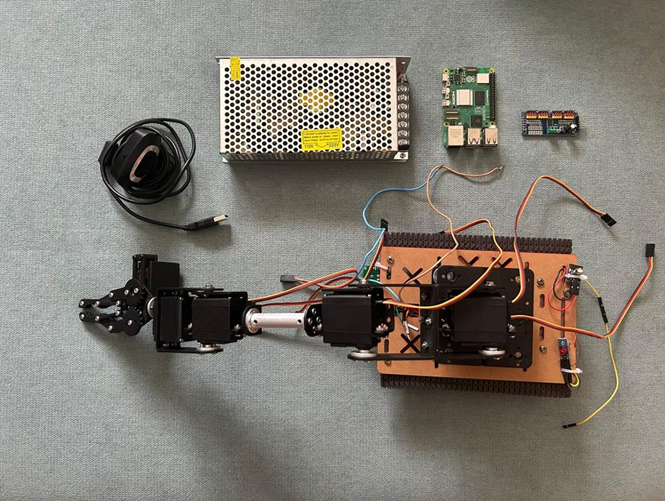
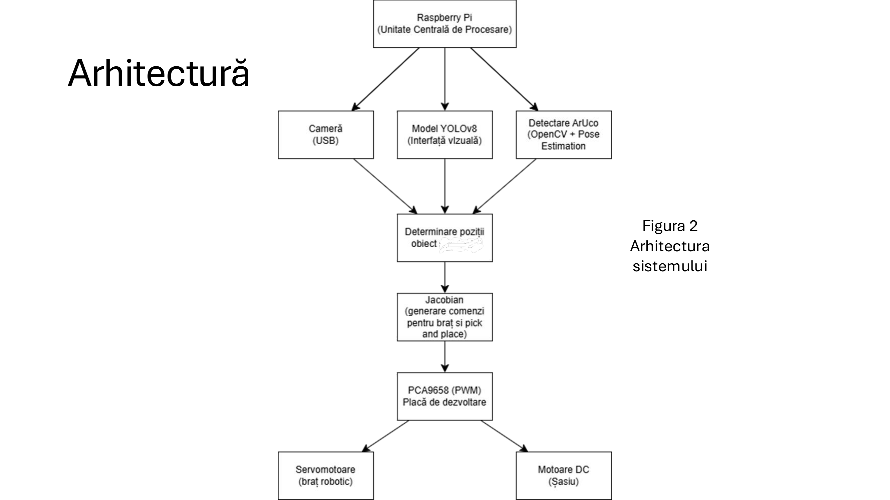
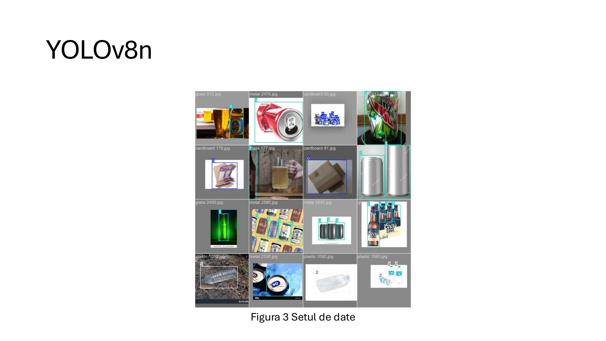
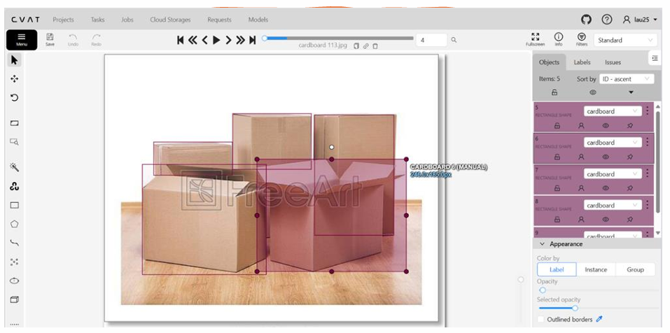
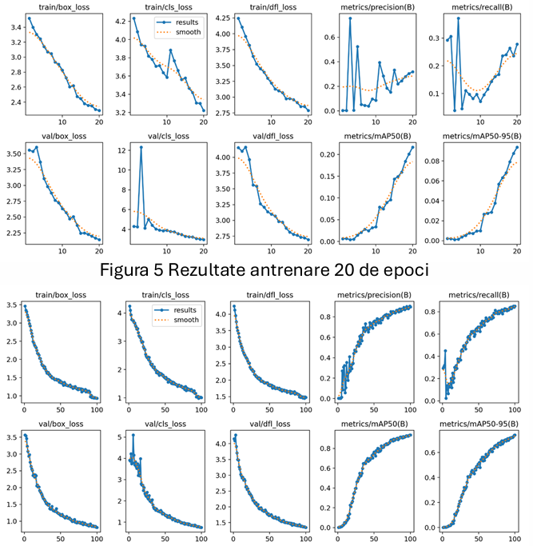
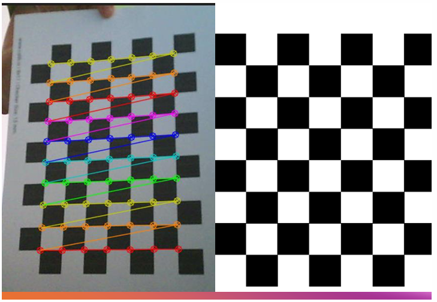
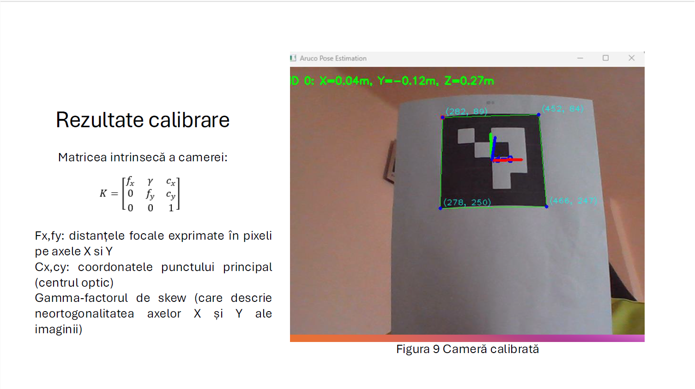
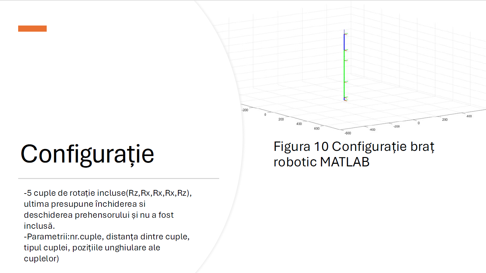

## Overview

This repository contains a robotics project focused on the development of an autonomous waste-sorting system. The system combines a mobile tracked chassis, a robotic arm, computer vision, and robotic kinematics to detect and sort recyclable waste according to material type.

The main objective is to automate the identification and handling of recyclable objects, including plastic, glass, aluminum, and cardboard, using a Raspberry Pi 5 as the central processing unit.

The project integrates YOLOv8n for object detection, ArUco markers for camera-based positioning, and MATLAB simulations for analyzing the robotic arm's configuration, Jacobian, and inverse kinematics.

## Components

Mobile Platform: Tracked chassis equipped with two DC motors controlled through an L9110 motor driver.

Robotic Arm: A serial manipulator with six MG996R servo motors, including the gripper mechanism.

Central Processing Unit: Raspberry Pi 5.

Servo Control: PCA9685 PWM driver board.

Vision System: Canyon webcam used for object detection and marker-based positioning.

Power Supply: 5V, 20A

## Architecture

Degrees of Freedom (DoF): Five rotational joints are considered for the kinematic model, while the sixth servo operates the gripper separately.

## Object Detection

The system uses YOLOv8n to identify recyclable waste in camera images. The detection model was trained on a custom dataset containing images of four material categories:

Class 0 — Cardboard

Class 1 — Glass

Class 2 — Plastic

Class 3 — Aluminum

The dataset was manually annotated, and the training process was evaluated at 20 and 100 epochs.

Approximately 130 images were used for each material category during dataset preparation and model training.

## ArUco Marker Detection & Camera Calibration

ArUco markers are used to estimate the position of a reference marker relative to the camera. The detected marker corners, camera calibration parameters, and marker dimensions are used to estimate its pose.

The pose estimation provides:

Rotation vector (rvec): Represents the marker's orientation relative to the camera.

Translation vector (tvec): Represents the marker's position relative to the camera.

Camera matrix (cameraMatrix): Contains the intrinsic camera parameters.

Distortion coefficients (distCoeffs): Describe the camera's optical distortion.

These parameters support camera-based positioning and provide geometric information that can be used by the robot's positioning system.

Camera calibration was performed using the Zhang calibration method to determine the intrinsic parameters and optical distortion coefficients.

The intrinsic matrix contains the focal lengths along the X and Y image axes, the principal point coordinates, and the skew factor.

## MATLAB Simulation

The kinematic chain consists of five rotational joints with the following rotation sequence:

Rz → Rx → Rx → Rx → Rz

The gripper's opening and closing mechanism is handled separately and is not included in the five-joint kinematic model.

Inverse kinematics is used to calculate the joint angles required to reach a desired end-effector position.

The simulation uses the target position:

P = [300, 0, 220] mm

The target height of 220 mm approximates the height of a 0.5-liter bottle.

An iterative Jacobian-based method updates the joint configuration according to the positional error between the desired point and the current end-effector position.

## Technologies
- Raspberry Pi 5
- Python
- OpenCV
- YOLOv8
- MATLAB
- ArUco Markers
